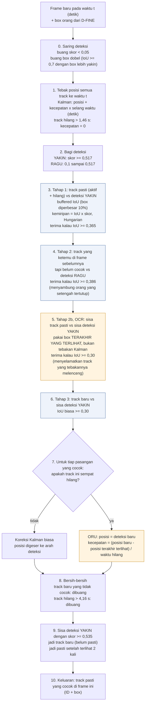
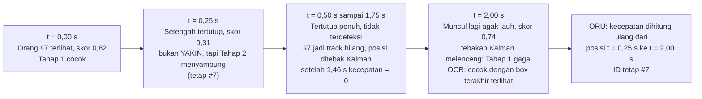

# Lite tuned: tracker terbaik untuk CCTV FPS rendah

Kode: `src/object_tracking/lite.py` (`LiteTracker.update` dan `predict`). API untuk pipeline: `src/object_tracking/integration.py` (`PersonTracker`, `LiteForComplianceTracker`). Untuk perbandingan: `TrackerRunner` di `zoo.py`
Parameter: `configs/tracker_tuned.json`, kunci `"Lite tuned"`, dan `LITE_PRESETS` di `integration.py` (satu set per detektor)

> Dokumen ini menjelaskan Lite tuned untuk detektor `dfine-n-1248x704-commercial-v3`. Dengan detektor `dfine-n-960x540-stride-8`, hasil tuning mematikan OCR, ORU, dan box diperbesar (lihat `TRACKING_SUMMARY.md`). Alur di bawah tetap sama, hanya langkah yang opsinya mati dilewati.
Perbandingan dengan tracker lain: [TRACKING_SUMMARY.md](TRACKING_SUMMARY.md)
Lisensi, sumber ilmiah, dan cara membaca IDF1: [TRACKER_LISENSI_DAN_SUMBER.md](TRACKER_LISENSI_DAN_SUMBER.md)

## Kenapa ini yang terbaik

Di 5 klip kamera test (2 sampai 6 FPS), Lite tuned mendapat IDF1 **0,828** dengan **76** ID switch. Pembanding:

| Tracker | IDF1 | ID switch |
|---|---|---|
| ByteTrack tuned (tracker standar terbaik) | 0,766 | 108 |
| ByteTrack pipeline sekarang | 0,649 | 223 |

Keunggulan Lite tuned paling besar di **2 sampai 4 FPS**. Di 4 FPS, IDF1-nya 0,872, dibanding 0,815 untuk ByteTrack tuned.

Alasannya ada tiga hal yang membuatnya cocok untuk CCTV FPS rendah:
1. **Gerak dihitung per detik, bukan per frame.** Model gerak tetap benar di 2 FPS maupun 6 FPS, dan saat ada frame yang dilewati.
2. **Ada empat kesempatan untuk menyambung orang ke ID lamanya** sebelum dianggap orang baru: deteksi yakin, deteksi ragu-ragu, posisi terakhir yang terlihat (OCR), lalu kandidat track baru.
3. **Orang yang sempat hilang tidak "terbang".** Kecepatannya dibuat nol setelah hilang 1,5 detik, lalu dihitung ulang dari posisi nyata saat ketemu lagi (ORU).

## Istilah

| Istilah | Artinya |
|---|---|
| **Track** | Satu orang yang sedang diikuti, punya ID tetap |
| **Track pasti** (confirmed) | Track yang sudah terlihat minimal 2 kali. Hanya ini yang ditampilkan |
| **Track baru** (tentative) | Baru terlihat 1 kali, belum diberi tampilan. Dibuang kalau tidak muncul lagi di frame berikutnya |
| **Track hilang** | Track pasti yang tidak ketemu di frame ini. Tetap diingat sampai 4,2 detik |
| **Kalman filter** | Model gerak: menebak posisi orang di frame berikutnya dari posisi dan kecepatannya, lalu dikoreksi dengan deteksi |
| **IoU** | Seberapa besar dua box bertumpuk (0 = tidak sama sekali, 1 = identik) |
| **Buffered IoU** | IoU setelah kedua box diperbesar 10% di tiap sisi. Membantu saat orang bergeser jauh antar frame |
| **Hungarian** | Cara memasangkan banyak track dengan banyak deteksi sekaligus, sehingga total kecocokannya paling besar |

## Alur per frame

Setiap frame, detektor (D-FINE) memberi daftar box orang beserta skornya. Lalu:

Kotak oranye adalah dua ide dari OC-SORT (OCR dan ORU) yang ditambahkan ke tracker ini. Menurut ablasi, **OCR paling berpengaruh**: tanpa OCR, IDF1 turun 0,024 dan ID switch naik dari 76 ke 104.

### Frame tanpa deteksi (mode `det/2`)

Kalau detektor hanya jalan tiap N frame, frame di antaranya memakai langkah 1 saja. Posisi ditebak Kalman, lalu track pasti yang terakhir terlihat paling lama 1 detik lalu ditampilkan sebagai box tebakan. Mode ini **tidak disarankan**: IDF1 turun ke 0,70. Lebih baik turunkan FPS proses dan tetap deteksi di setiap frame.

## Contoh: orang tertutup forklift sebentar (4 FPS)

Tanpa Tahap 2, OCR, dan ingatan 4,2 detik, orang ini kemungkinan muncul lagi sebagai ID baru (#12). Hal seperti ini yang membuat pipeline sekarang membuat 271 ID untuk 196 orang.

## Parameter Lite tuned

| Langkah | Parameter | Bawaan | Tuned | Pengaruh |
|---|---|---|---|---|
| 0 | `person_min` | 0,10 | 0,05 | Lihat catatan di bawah |
| 0 | `nms_iou` | 0,6 | 0,7 | Hanya box yang hampir identik dianggap dobel; dua orang berdempetan tidak saling menghapus |
| 1 | `std_vel` / `std_pos` | 0,6 / 0,05 | 0,89 / 0,10 | Kalman lebih cepat menyesuaikan diri kalau orang berbelok atau berhenti |
| 1 | `lost_velocity_decay_sec` | 1,0 s | 1,46 s | Berapa lama track hilang masih "bergerak" sebelum dianggap diam |
| 2 | `high_thresh` | 0,50 | 0,517 | Batas deteksi YAKIN |
| 2 | `low_thresh` | 0,10 | 0,10 | Batas bawah deteksi RAGU |
| 3 | `buffers` | 0,1 lalu 0,4 | 0,1 saja | Pembesaran 40% ternyata terlalu longgar (dua orang berdekatan tertukar). OCR mengambil alih kasus gerak jauh |
| 3 | `min_iou` | 0,30 | 0,365 | Tahap 1 sedikit lebih ketat |
| 4 | `min_iou_low` | 0,40 | 0,386 | |
| 5 | `ocr` | mati | **nyala** | Paling berpengaruh |
| 7 | `oru` | mati | nyala | Pengaruh kecil (di bawah 0,005 IDF1) |
| 7 | `nsa` | nyala | mati | Pengaruh kecil |
| 8 | `max_lost_sec` | 3,0 s | 4,16 s | Orang yang tertutup lebih lama tetap dapat ID lamanya |
| 9 | `new_thresh` | 0,55 | 0,535 | Skor minimal untuk ID baru |
| 9 | `confirm_hits` | 2 | 2 | Satu deteksi palsu tidak langsung jadi ID |

Catatan tentang `person_min` 0,05: deteksi dengan skor 0,05 sampai 0,1 lolos saringan, tapi tidak dipakai di tahap mana pun karena `low_thresh` = 0,1. Dalam praktiknya hasilnya sama dengan `person_min` 0,1. Kalau dipasang di pipeline, sebaiknya ditulis 0,1 supaya tidak membingungkan.

## Batasan

- Tidak ada Re-ID (pengenalan penampilan). Ini disengaja: seragam pekerja mirip, dan brief melarang identifikasi orang. Akibatnya, dua orang yang berpapasan rapat lalu sama-sama tertutup masih bisa tertukar ID.
- Angka IDF1 dinilai terhadap dua tracker referensi, bukan label manusia. Klip test tersulit adalah v07 (IDF1 0,72) dan v12 (0,77).
